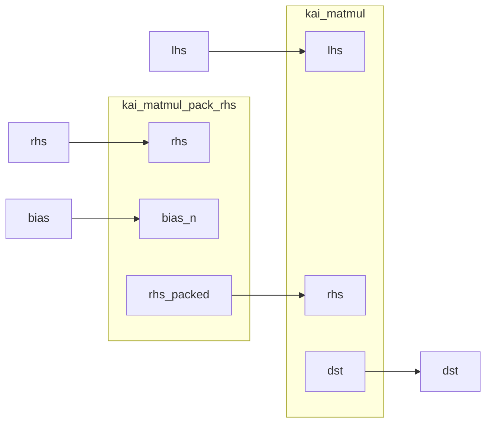
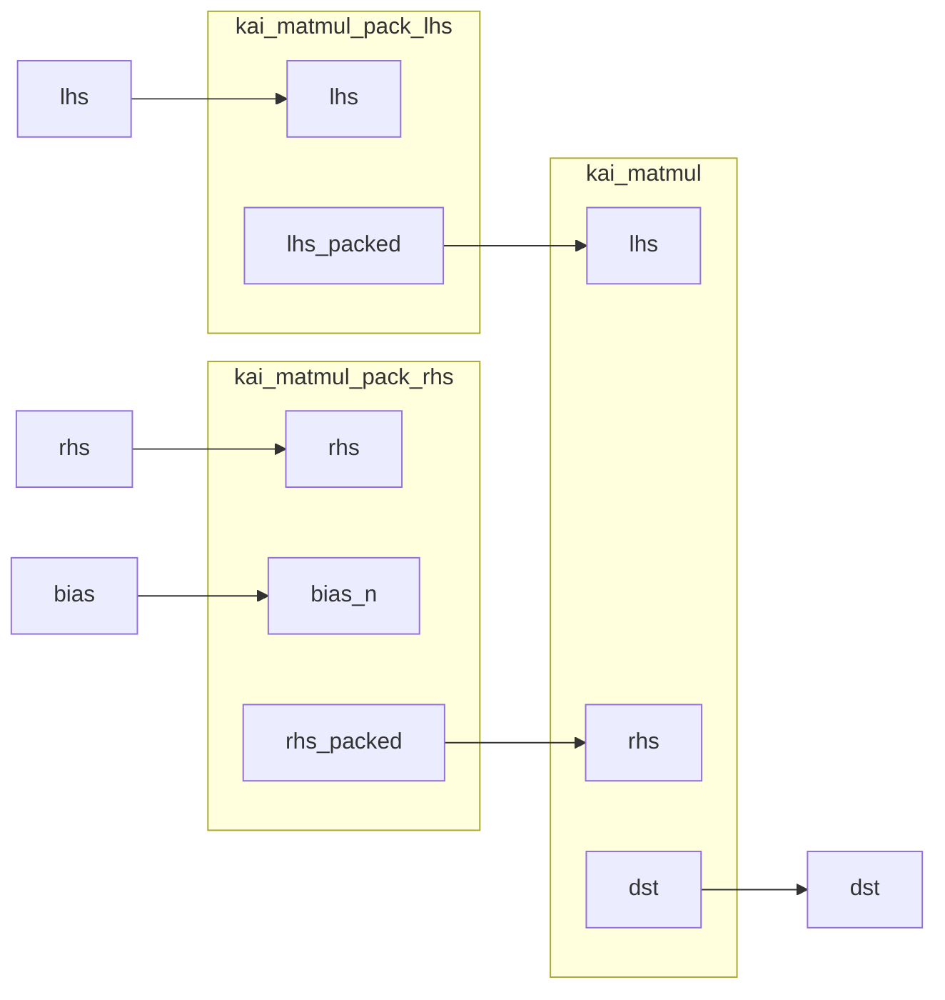

<!--
    SPDX-FileCopyrightText: Copyright 2026 Arm Limited and/or its affiliates <open-source-office@arm.com>

    SPDX-License-Identifier: Apache-2.0
-->

# Floating-point matrix multiplication

This document gives the high-level mathematical overview of floating-point matrix multiplication, how it can be performed using multiple micro-kernels and how each operand should be prepared and provided to the micro-kernels.

## Background

Matrix multiplication can be expressed as follows:

$$f^D_{mn} = f^B_n + \sum_{k = 0}^{K - 1} f^L_{mk} f^R_{kn} \qquad \forall m \in \{0, \dots, M - 1\}, n \in \{0, \dots, N - 1\}$$

where:

- $M$, $N$, $K$ - the problem shape.
- $f^L_{mk}$ - LHS data at row $m$, column $k$.
- $f^R_{kn}$ - RHS data at row $k$, column $n$.
- $f^B_n$ - Per-N bias data at index $n$.
- $f^D_{mn}$ - output data at row $m$, column $n$.

## Methods

There are 2 main groups of methods to perform floating-point matrix multiplication:

- With RHS packing only.
- With LHS and RHS packing.

The optional LHS packing kernel reorders the LHS data $f^L_{mk}$ into suitable format so that the subsequent matrix multiplication micro-kernel can perform at its best performance.

The RHS packing kernel performs multiple tasks:

- Reorders the RHS data $f^R_{kn}$ into suitable format.
- Packs the reordered RHS data and optional bias into suitable packed format.

The caller needs to provide the micro-kernels with the following operands:

- `lhs` - LHS data $f^L_{mk}$.
- `rhs` - RHS data $f^R_{kn}$.
- `bias` - Per-n bias data $f^B_n$.
- `dst` - Output data $f^D_{mn}$.

## Group 1

This group contains methods that require RHS packing but not LHS packing.

Micro-kernels compatible with this method:

- `kai_matmul_clamp_f32_f32_f32p4vsx1bf32_1x32vs_sme2_mla`
- `kai_matmul_clamp_f16_f16_f16p16vsx2bf16_6x16vs_sve2p1_dot`
- `kai_matmul_clamp_f16_f16_f16p4vsx2bf16_1x32vs_sme2_dot`

## Group 2

This group contains methods that require both LHS and RHS packing.

Micro-kernels compatible with this method:

- `kai_matmul_clamp_f16_f16p4vsx2_f16p4vsx2bf16_8vsx8vs_sme2_mopa`
- `kai_matmul_clamp_f32_f32p4vsx1_f32p4vsx1bf32_8vsx8vs_sme2_mopa`
- `kai_matmul_clamp_f32_f32p4vsx1_f32p4vsx1bf32_8vsx8vs_sme2p1_mop4_mopa`
