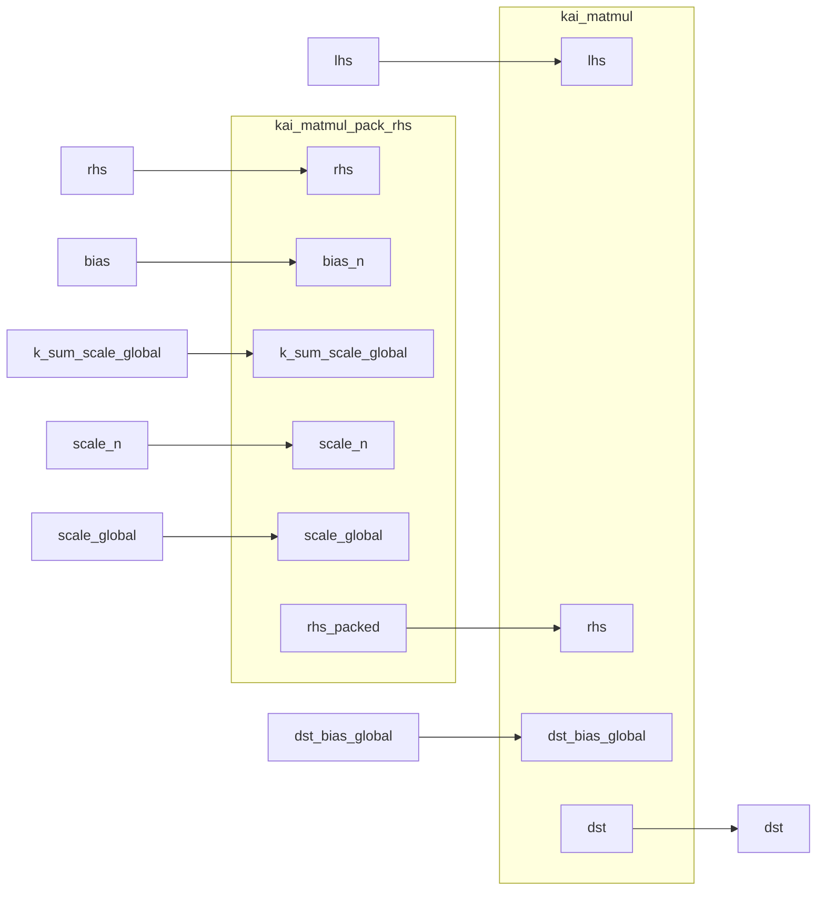
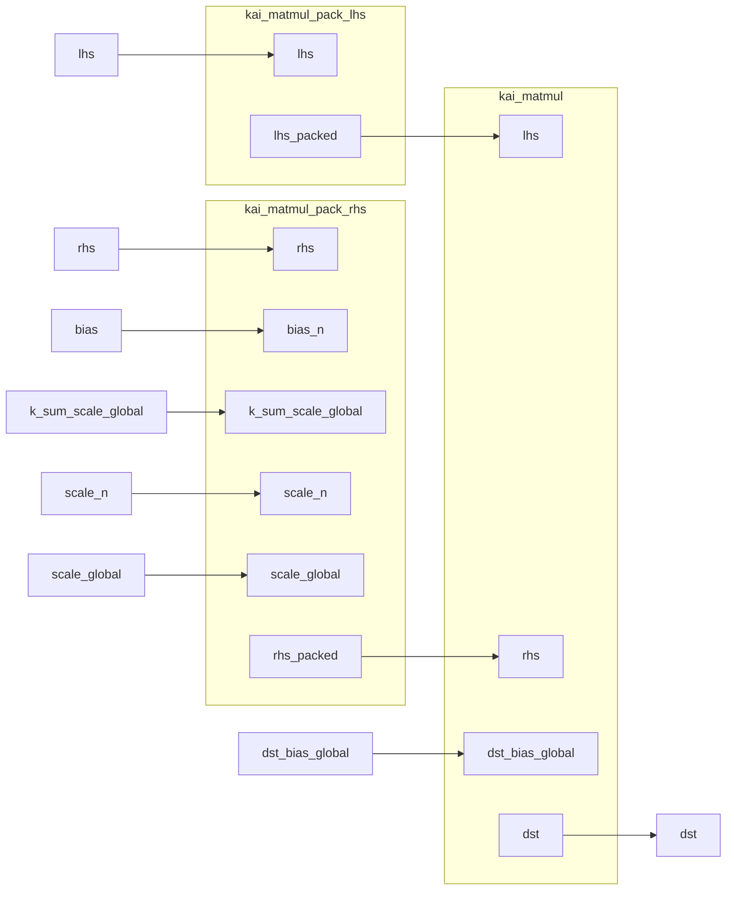

<!--
    SPDX-FileCopyrightText: Copyright 2026 Arm Limited and/or its affiliates <open-source-office@arm.com>

    SPDX-License-Identifier: Apache-2.0
-->

# Static quantized matrix multiplication

This document gives the high-level mathematical overview of static quantized matrix multiplication, how it can be performed using multiple micro-kernels and how each operand should be prepared and provided to the micro-kernels.

## Background

Matrix multiplication can be expressed as follows:

$$f^D_{mn} = f^B_n + \sum_{k = 0}^{K - 1} f^L_{mk} f^R_{kn} \qquad \forall m \in \{0, \dots, M - 1\}, n \in \{0, \dots, N - 1\}$$

where:

- $M$, $N$, $K$ - Problem shape.
- $f^L_{mk}$ - LHS data at row $m$, column $k$.
- $f^R_{kn}$ - RHS data at row $k$, column $n$.
- $f^B_n$ - Per-N bias data at index $n$.
- $f^D_{mn}$ - Output data at row $m$, column $n$.

A floating-point value can be quantized using scale and optional zero-point as follows:

$$f = (q - z) \times s$$

where:

- $f$ - floating-point value.
- $q$ - quantized value.
- $z$ - quantization zero-point.
- $s$ - quantization scale.

Quantization zero-point is optional. If zero-point is not available, it is symmetric quantization, otherwise it is asymmetric quantization.

Static quantization is a popular technique to quantize the model so that the computation is perform mostly on low precision integer types and therefore can be much faster. Each operand is quantized as follows:

- LHS quantization is asymmetric per-matrix, i.e. it has one scale $s^L$ and one zero-point $z^L$.
- RHS quantization is symmetric per-N, i.e. it has N scale $s^L_n$ and no zero-point.
- Per-N bias quantization is symmetric per-N with the scale being $s^B_n = s^L s^R_n$.
- Output quantization is asymmetric per-matrix, i.e. it has one scale $s^D$ and one zero-point $z^D$.

The static quantized matrix multiplication formula becomes:

$$q^D_{mn} = \cfrac{s^L s^R_n}{s^D} \left[ \sum_{k = 0}^{K - 1} q^L_{mk} q^R_{kn} + \left( q^B_n - z^L \sum_{k = 0}^{K - 1} q^R_{kn} \right) \right] + z^D$$

where:

- $q^L_{mk}$ - LHS data at row $m$, column $k$.
- $s^L$ - LHS scale.
- $z^L$ - LHS zero-point.
- $q^R_{kn}$ - RHS data at row $k$, column $n$.
- $s^R_n$ - RHS per-N scale at index $n$.
- $q^B_n$ - Per-N bias data at index $n$.
- $q^D_{mn}$ - Output data at row $m$, column $n$.
- $s^D$ - Output scale.
- $z^D$ - Output zero-point.

## Methods

There are 2 main groups of methods to perform static quantized matrix multiplication:

- With RHS packing only.
- With LHS and RHS packing.

The optional LHS packing kernel reorders the LHS data $q^L_{mk}$ into suitable format so that the subsequent matrix multiplication micro-kernel can perform at its best performance.

The RHS packing kernel performs multiple tasks:

- Reorders the RHS data $q^R_{kn}$ into suitable format.
- Computes the initial accumulator bias $\left( q^B_n - z^L \sum_{k = 0}^{K - 1} q^R_{kn} \right)$.
- Computes the combined scale $\cfrac{s^L s^R_n}{s^D}$.
- Packs the 3 components above into suitable packed format.

The caller needs to provide the micro-kernels with the following operands:

- `lhs` - LHS data $q^L_{mk}$.
- `rhs` - RHS data $q^R_{kn}$.
- `bias` - Per-N bias data $q^B_n$.
- `k_sum_scale_global` - RHS reduction sum scale factor $\left( -z^L \right)$.
- `scale_n` - Per-N scale factor $s^R_n$.
- `scale_global` - Global scale factor $\cfrac{s^L}{s^D}$.
- `dst_bias_global` - Global output bias $z^D$.
- `dst` - Output data $q^D_{mn}$.

## Group 1

This group contains methods that require RHS packing but not LHS packing.

Micro-kernels compatible with this method:

- `kai_matmul_clamp_qai8_qai8_qsu2cxp16vsx4sf32bi32_1x64vs_sme2_dot`
- `kai_matmul_clamp_qai8_qai8_qsi8cxp4vsx4bi32sf32_1x32vs_sme2_dot`
- `kai_matmul_clamp_qai8_qai8_qsi4cxp8vsx4sf32bi32_1x64vs_sme2_dot`
- `kai_matmul_clamp_qai8_qai8_qsi8cxp16x4sf32bi32_1x16_neon_dotprod`
- `kai_matmul_clamp_qai8_qai8_qsi8cxp16x4sf32bi32_4x16_neon_dotprod`

## Group 2

This group contains methods that require both LHS and RHS packing.

Micro-kernels compatible with this method:

- `kai_matmul_clamp_qai8_qai8p8vsx4_qsi4cxp8vsx4sf32bi32_8vsx8vs_sme2_mopa`
- `kai_matmul_clamp_qai8_qai8p4vsx4_qsi8cxp4vsx4sf32bi32_8vsx8vs_sme2p1_mop4_mopa`
- `kai_matmul_clamp_qai8_qai8p8vsx4_qsu2cxp16vsx4sf32bi32_8vsx16vs_sme2_mopa`
- `kai_matmul_clamp_qai8_qai8p4vsx4_qsi8cxp4vsx4bi32sf32_8vsx8vs_sme2_mopa`
